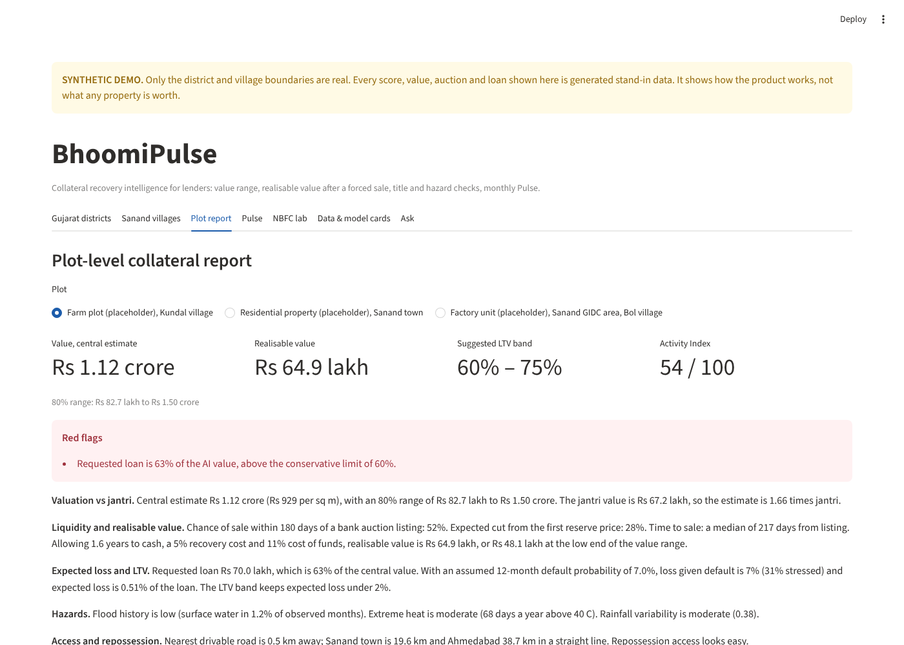
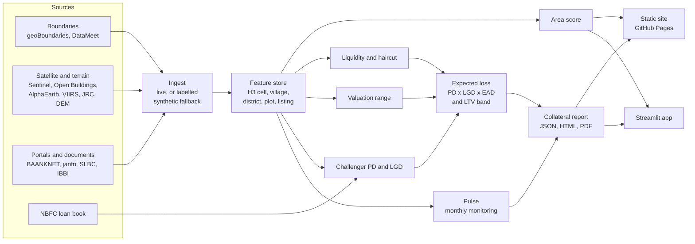

# BhoomiPulse: collateral recovery intelligence (prototype)

BhoomiPulse tells a lender what pledged land, property or a factory will actually fetch after a default, how fast, and how that changes
every month. For any asset it produces a value range, the realisable value after a forced sale, title and hazard checks, a suggested
loan-to-value band, and a monthly activity "Pulse". It also takes an NBFC's loan book and tests whether collateral features beat the
lender's existing score.

> ## SYNTHETIC / prototype-only: read this first
> This build ran in an environment that could reach only GitHub. **Only the map boundaries are real** (33 Gujarat districts, 67 Sanand
> villages) plus one IBBI recovery figure. Satellite layers, auction listings, jantri rates, district credit data and the NBFC loan book
> are **generated stand-ins**, labelled SYNTHETIC in every table, report and screen. The model metrics show that the pipeline and the
> evaluation design work. They are **not** evidence of accuracy on real Indian collateral. See
> [`reports/validation.md`](reports/validation.md).

**Live links**

- Static demo site: <https://silverintegral13.github.io/geospatial-intel/>
- Interactive app: not deployed yet; see [Deploy the app](#deploy-the-app) (about two minutes)



## What is in the prototype

| Layer | What it does | Status in this build |
| --- | --- | --- |
| District map | Collateral-quality score for Gujarat districts | Real boundaries, synthetic score inputs |
| Village drill-down | 67 Sanand villages and 1,148 H3 cells | Real boundaries, synthetic layers |
| Plot report | Value range, jantri comparison, liquidity, realisable value, expected loss, LTV band, hazards, title, Pulse; JSON + HTML + PDF | Three placeholder plots, synthetic inputs |
| Pulse | Farm sowing check, construction progress, factory night-light activity, Activity Index | Synthetic series with two scripted events |
| NBFC lab | Upload a loan book; champion vs refit vs challenger, swap set, LGD, LTV grid, collections list, FREE-AI model card | Synthetic 20,000-loan book |
| Ask | Questions answered by tool functions over the feature store | Keyword router; Claude tool-calling if a key is set |

## Architecture



## Quick start

```bash
git clone https://github.com/silverintegral13/geospatial-intel && cd geospatial-intel
python3.11 -m venv .venv && source .venv/bin/activate
pip install -r requirements.txt -r requirements-dev.txt
make hooks                      # pre-commit guard: large files, secrets, restricted data
streamlit run app/main.py       # demo mode: uses the committed demo data, no keys needed
```

Rebuild everything (about one minute with the synthetic fallback):

```bash
make all      # data -> features -> train -> report -> assets -> site -> test
```

| Target | What it does |
| --- | --- |
| `make data` | Ingests every source. Live where the host answers; otherwise a labelled synthetic fallback. Writes `data/sources.yaml`. |
| `make features` | Feature store in `data/demo/` with `data_dictionary.csv` (each column marked real or synthetic). |
| `make train` | Models, `models/metrics.json`, model cards, Pulse, NBFC lab. |
| `make report` | Three collateral reports and `reports/validation.md`. |
| `make assets` / `make site` | Deck assets and the static site. |
| `make scan` | Scans the full git history for secrets and restricted files. |

### Going live

1. `pip install -r requirements-full.txt`
2. Copy `.env.example` to `.env`. Set `GEE_PROJECT` (Earth Engine: Open Buildings, AlphaEarth embeddings, night lights, terrain,
   rainfall, heat). Sentinel-1/2 need no key. `ANTHROPIC_API_KEY` is optional (report prose, land-record extraction, chat).
3. Put your three plots in `config.yaml`.
4. Fill the CSV templates in `data/templates/` (auction listings, jantri, district credit) and save them in `data/manual/`.
5. `make all`.

**The live fetchers have never been run.** `bhoomipulse/ingest/live_stac.py`, `live_gee.py` and `live_osm.py` were written against the
public APIs but could not be exercised where this was built. Expect to debug them on the first live run.

## Models and how they are tested

| Model | Target | Hold-out | Result on synthetic data |
| --- | --- | --- | --- |
| Area score | District NPA ratio | Whole districts held out; last year held out | Spearman 0.90 (flattering: simple synthetic target, 33 districts) |
| Liquidity | Sold within 180 days; haircut; days to sale (censored) | Listings after 2025-10-01 | AUC 0.63, C-index 0.63; haircut model is no better than the mean |
| Valuation | Bank reserve price per sq m, 80% split-conformal range | 7 unseen districts | MAPE 18%, interval coverage 81% |
| PD x LGD demo | Default and loss by LTV band | Out-of-time | Gini 0.41; runs on the synthetic book, not Freddie Mac |
| NBFC challenger | 90+ days past due in 12 months | Loans originated later | Gini 0.35 to 0.45; the lift is built into the synthetic book |

Fairness: no caste, religion, community or other demographic variable is a feature (a test enforces it). Outcomes by region are reported.

## Data sources

Every source, with URL, licence, access date, row count and mode, is in [`data/sources.yaml`](data/sources.yaml) and on the site's
Data sources page. Modes: `live` (fetched), `manual` (hand-transcribed), `synthetic` (fallback), `template` (not collected).

### Portal parsers

Two parsers turn pages or notices you have saved into the CSVs that `make data` reads. Neither crawls a portal.

| Parser | Input | Output |
| --- | --- | --- |
| Auction sale notices (BAANKNET / SARFAESI wording) | A folder of saved `.txt`, `.html` or `.pdf` notices, or a list of listing URLs fetched politely (robots.txt, 5-second gap, cache) | `data/manual/baanknet_listings.csv` with reserve price, EMD, auction date, area in sq m, bank, asset type, district; repeat notices for one property are linked into re-listing rounds |
| Saved-page tables | A saved HTML page with a table: jantri rates, RERA projects or district credit | `data/manual/jantri.csv` etc., through header aliases in `bhoomipulse/ingest/parsers.py` |

```bash
python -m bhoomipulse.ingest.parse_saved notices data/manual/saved_notices/
python -m bhoomipulse.ingest.parse_saved notices --urls data/manual/notice_urls.txt
python -m bhoomipulse.ingest.parse_saved table jantri data/manual/saved_pages/jantri.html
```

- **Not verified on live pages.** The portals could not be opened where this was built. The notice parser follows the field wording
  of public bank-auction listings and is tested on fictional fixtures in `tests/fixtures/`. Check the first real results by eye.
  The jantri header aliases are guesses until tried on a real saved page.
- Nothing is guessed: a notice missing area, price, date, type or district goes to `baanknet_needs_review.csv`. Local land units
  (bigha, vigha) are not converted because they vary by district.
- A sale notice does not say whether the auction succeeded. Fill `sold` and `final_price` by hand where known; blanks count as
  "unsold so far".
- Geocoding is district-centre only (confidence 0.5). Add exact coordinates where you can.
- Models switch to real listings once at least 300 usable rows exist; fewer are kept for validation only.
- AnyROR, eCourts and Gujarat RERA still have templates only. Read each portal's terms before fetching anything.

Prototype-only data, if you add them: **SHRUG** (non-commercial licence) and the **Freddie Mac** loan-level data (no redistribution).
Neither is used or committed here.

## Not built or not wired yet

- Live state-wide point features (auction listings and loans use synthetic features even after `make data` goes live for Sanand).
- AnyROR and eCourts parsers (both sit behind captchas); a BAANKNET crawler (the notice parser needs saved pages or a URL list); Bhoonidhi; Fields of The World download; ESA WorldCover feature.
- Freddie Mac / SBA loader for the PD demo.
- Land-record OCR and extraction is written but untested (no sample document; the Gujarati Tesseract pack was not installed).
- From the planned stack: MAPIE (split conformal is implemented directly), SHAP (LightGBM's built-in contributions are used),
  fairlearn, optbinning, Evidently, MLflow, FastAPI, PostGIS, OSRM, IndicTrans2, TorchGeo.
- Gujarat's 34th district (Vav-Tharad) is shown inside Banas Kantha, because open boundary files still carry 33 districts.

## Deploy the app

GitHub Pages cannot run Python, so the interactive app deploys to Streamlit Community Cloud from this repo:

1. Go to <https://share.streamlit.io>, sign in with GitHub, and choose **Create app**.
2. Repository `silverintegral13/geospatial-intel`, branch `main`, main file `app/main.py`.
3. Under **Advanced settings** choose Python 3.11. Secrets are optional (`ANTHROPIC_API_KEY = "..."`).
4. Deploy. `packages.txt` installs the PDF libraries; `requirements.txt` installs the rest.
5. Link it from the Pages site: `gh variable set APP_URL --body "https://<your-app>.streamlit.app"`, then re-run the **Pages** workflow.

If Streamlit Community Cloud is unavailable, create a Hugging Face Space (SDK: Streamlit) and push this repo to it.

## Public-repo rules

Never commit secrets, `data/raw`, satellite rasters, licence-restricted data, portal scrapes, scanned land records, or anything naming an
owner or borrower. `.gitignore`, the pre-commit guard (`make hooks`) and the CI guard enforce this.

## Licence

Code: MIT ([LICENSE](LICENSE)). Every dataset keeps its original licence; see `data/sources.yaml`.
Reports carry the line "AI-assisted second opinion; does not replace a registered valuer."
